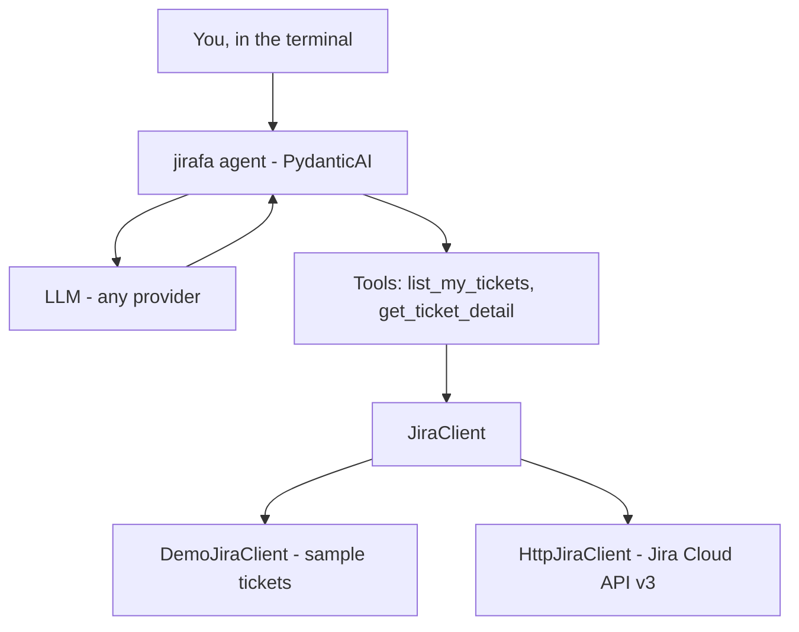
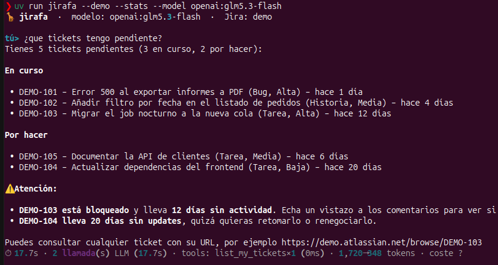

<div align="center">

<h1>🦒 jirafa</h1>

<p><strong>A terminal assistant that answers natural-language questions about your Jira tickets:<br>what you have, what status it's in, and what got stuck.</strong></p>


</div>

<p align="center">
🇪🇸 <a href="./README.md">Español</a> | 🇺🇸 <a href="./README.en.md">English</a>
</p>

## Table of Contents

- [Introduction](#introduction)
- [Installation](#installation)
- [Usage](#usage)
- [Reference](#reference)
- [Development](#development)
- [Roadmap](#roadmap)
- [License](#license)

## Introduction

**jirafa** is a terminal AI agent. You ask about your Jira tickets in natural language and it answers by querying Jira for you.

- 💬 **Natural language**: "what's pending for me?", "is anything blocked?", "what do the comments on PROJ-123 say?".
- 🔌 **LLM-agnostic**: Claude, GPT, Gemini, Bedrock… switch with one environment variable.
- 🔒 **Read-only**: it never creates, edits or moves tickets. It uses your own token, so it only sees what you already see in Jira.
- 🧪 **Demo mode**: sample tickets to try it without Jira access.

### How it works

<!-- Experimental: if rendering fails, preview on GitHub -->


The LLM decides which tool it needs; jirafa runs it, hands back the result, and the LLM writes the answer. Deterministic work (JQL queries, dates, days since last update) is done in code; the LLM interprets and summarizes.

## Installation

**Requirements**: [uv](https://docs.astral.sh/uv/) (installs Python 3.13 if needed) and an API key from an LLM provider.

```bash
uv sync                     # crea el entorno e instala dependencias
cp .env.example .env        # y rellena tu API key
uv run jirafa --demo        # prueba con tickets de ejemplo
```

> [!WARNING]
> Run jirafa **from the project root**: configuration is read from the `.env` file in the current directory.

> [!CAUTION]
> `.env` holds secrets (API key, Jira token). It's in `.gitignore`: never commit it.

<details>
<summary><strong>Connect to your real Jira</strong></summary>

1. Create an Atlassian API token at <https://id.atlassian.com/manage-profile/security/api-tokens>.
2. In `.env`:

   ```bash
   JIRA_MODE=real
   JIRA_URL=https://<YOUR_COMPANY>.atlassian.net
   JIRA_EMAIL=<YOUR_EMAIL>
   JIRA_API_TOKEN=<YOUR_JIRA_API_TOKEN>
   ```

3. `uv run jirafa`

If any of the three values is missing, jirafa refuses to start and tells you which one.

</details>

## Usage

**One question, then exit:**

```bash
uv run jirafa "¿qué tengo pendiente?"
```

jirafa lists your open tickets **grouped by status**, with key, title, priority and days since last update, and flags the ones that look stuck (blocked, or no changes for more than 7 days).

**Interactive chat** (it remembers the conversation, so you can ask follow-ups):

```bash
uv run jirafa
```

To quit: `salir`, `exit`, `quit`, `q` or `Ctrl-D`.

> [!NOTE]
> Each question has a safety limit of 10 LLM calls and 15 tool calls, so a confused model can't loop forever or run up costs.

**Metrics** (`--stats`): after each answer it shows latency, LLM calls, per-tool usage (with retries and failures), tokens and cost; when leaving the chat, the session totals.

```bash
uv run jirafa --stats "¿qué tengo pendiente?"
# example: ⏱ 3.2s · 2 llamada(s) LLM (2.9s) · tools: list_my_tickets×1 (45ms) · 1,840→310 tokens · $0.0081
```

To keep them, set `JIRAFA_METRICS_FILE=logs/metrics.jsonl`: one JSON line per question, **numbers only**, never questions or ticket content. Cost is computed by PydanticAI from each provider's price table; if the model is unknown, it shows `coste ?`.

**Tested with a real model**: GLM 5.3 Flash (open-weight) served by [NaN](https://nan.builders) through its OpenAI-compatible API, with the demo tickets. jirafa called the tool once and applied the attention rules (blocked, stale) without making anything up:

<p align="center">
  
</p>

```bash
# Any OpenAI-compatible API: base URL + key from environment variables
export OPENAI_BASE_URL=https://api.nan.builders/v1
export OPENAI_API_KEY=<YOUR_API_KEY>
uv run jirafa --demo --stats --model openai:glm5.3-flash
```

## Reference

### CLI options

| Option | Description |
|---|---|
| `"question"` | Single question; without it, the chat opens |
| `--model <provider:model>` | Overrides `JIRAFA_MODEL` for this run |
| `--demo` | Uses sample tickets, whatever `.env` says |
| `--model test` | No-LLM mode: fake model that only calls `list_my_tickets` (no API key, no cost) |
| `--stats` | Shows latency, calls, tokens and cost per question and per session |

### Configuration (`.env`)

| Variable | Default | Description |
|---|---|---|
| `JIRAFA_MODEL` | `anthropic:claude-sonnet-5-5` | Model in PydanticAI `provider:model` format (provider API model ID) |
| `ANTHROPIC_API_KEY` / `OPENAI_API_KEY` / `GOOGLE_API_KEY` | — | API key for the chosen provider |
| `JIRA_MODE` | `demo` | `demo` (sample tickets) or `real` (Jira Cloud) |
| `JIRA_URL` | — | `https://<YOUR_COMPANY>.atlassian.net` (required in `real`) |
| `JIRA_EMAIL` | — | Your Atlassian email (required in `real`) |
| `JIRA_API_TOKEN` | — | Your Atlassian API token (required in `real`) |
| `JIRAFA_BLOCKED_STATUSES` | `Blocked,Bloqueado,Impedimento,On Hold,En espera` | Statuses that mean blocked in your Jira (comma-separated) |
| `JIRAFA_STALE_AFTER_DAYS` | `7` | An open ticket with no changes for **more** than these days is stale |
| `JIRAFA_METRICS_FILE` | — | If set, each question's metrics are appended to this JSONL file |

### Agent tools

| Tool | Parameters | What it does |
|---|---|---|
| `list_my_tickets` | `include_done: bool = False` | Report on your assigned tickets (max. 50): totals per category, keys grouped by status, blocked, stale and the full list |
| `get_ticket_detail` | `key: str` | Description and latest 5 comments of a ticket |

### Library usage

```python
from jirafa.agent import Deps, build_agent
from jirafa.jira import DemoJiraClient

agent = build_agent("anthropic:claude-sonnet-5-5")
result = agent.run_sync("¿qué tengo pendiente?", deps=Deps(jira=DemoJiraClient()))
print(result.output)
```

## Development

```bash
uv run pytest            # 53 tests, no network or real LLM
uv run ruff check        # linter
uv run ruff format       # formatter
uv run mypy              # type checker (strict)
uv run python -m evals   # manual evals: DemoJira + real LLM (.env); not in CI
```

> [!NOTE]
> Evals (`evals/`) call a real LLM and spend tokens. They are not part of `pytest` or CI. Cases live in `evals/cases.yaml`.

```
src/jirafa/
├── cli.py           # terminal chat
├── agent.py         # instructions + tools + build_agent()
├── config.py        # Settings (reads .env)
├── models.py        # Ticket, TicketDetail, Comment
└── jira/
    ├── base.py          # JiraClient (Protocol) + JQL and validation
    ├── http_client.py   # real client (Jira Cloud REST v3)
    ├── demo_client.py   # sample client
    └── adf.py           # Atlassian Document Format → text

evals/                   # outside pytest/CI; needs an API key and spends tokens
├── cases.yaml           # questions + deterministic checks
├── runner.py            # DemoJira + real LLM, timeout/retry on stalls
└── __main__.py          # uv run python -m evals
```

**Adding a tool**: write an `async` function in `agent.py` with clear type hints and docstring (that's what the LLM reads), add it to `tools=[...]` in `build_agent()`, and cover it with a test in `tests/test_agent.py` using `FunctionModel`.

> [!IMPORTANT]
> Tests never call a real LLM: `tests/conftest.py` sets `ALLOW_MODEL_REQUESTS = False`.

## Roadmap

- [x] Agent with read-only tools
- [x] Demo mode
- [x] Tests without LLM or network
- [x] Type checker (mypy, strict mode)
- [x] Deterministic logic: stale and blocked tickets in code
- [x] Observability v1: latency, calls, tokens and cost (`--stats`, JSONL)
- [ ] Observability v2: OpenTelemetry traces (e.g. self-hosted Langfuse)
- [ ] Try against real Jira
- [x] Evals v1: thin harness + DemoJira + real LLM (`uv run python -m evals`)
- [ ] Triage agent reusing the Jira client

## License

[MIT](./LICENSE) © 2026 fabianfalon
