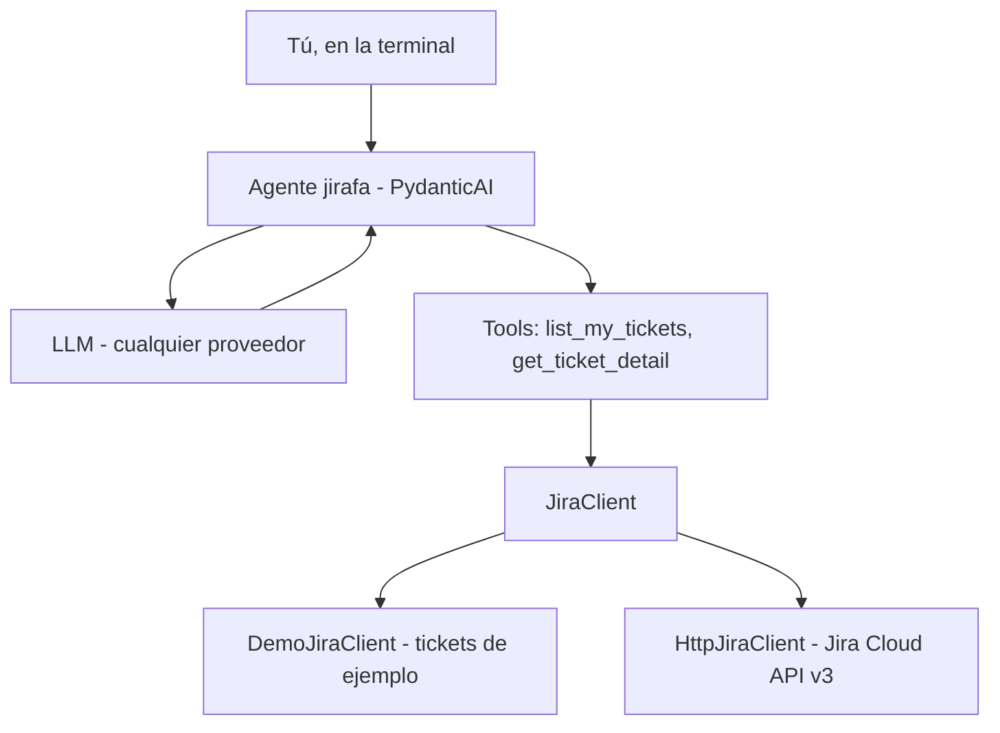

<div align="center">

<h1>🦒 jirafa</h1>

<p><strong>Asistente de terminal que responde en lenguaje natural sobre tus tickets de Jira:<br>qué tienes, en qué estado está y qué se ha quedado atascado.</strong></p>


</div>

<p align="center">
🇪🇸 <a href="./README.md">Español</a> | 🇺🇸 <a href="./README.en.md">English</a>
</p>

## Índice

- [Introducción](#introducción)
- [Instalación](#instalación)
- [Uso](#uso)
- [Referencia](#referencia)
- [Desarrollo](#desarrollo)
- [Hoja de ruta](#hoja-de-ruta)
- [Licencia](#licencia)

## Introducción

**jirafa** es un agente de IA de terminal. Le preguntas en lenguaje natural por tus tickets de Jira y responde consultando Jira por ti.

- 💬 **Lenguaje natural**: "¿qué tengo pendiente?", "¿hay algo bloqueado?", "¿qué dicen los comentarios del PROJ-123?".
- 🔌 **Independiente del LLM**: Claude, GPT, Gemini, Bedrock… se cambia con una variable de entorno.
- 🔒 **Solo lectura**: nunca crea, edita ni mueve tickets. Usa tu propio token, así que solo ve lo que tú ya ves en Jira.
- 🧪 **Modo demo**: tickets de ejemplo para probarlo sin acceso a Jira.

### Cómo funciona

<!-- Experimental: if rendering fails, preview on GitHub -->


El LLM decide qué tool necesita; jirafa la ejecuta, le devuelve el resultado y el LLM redacta la respuesta. Lo determinista (consultas JQL, fechas, días sin actualizar) lo hace el código; el LLM interpreta y resume.

## Instalación

**Requisitos**: [uv](https://docs.astral.sh/uv/) (instala Python 3.13 si hace falta) y una API key de un proveedor de LLM.

```bash
uv sync                     # crea el entorno e instala dependencias
cp .env.example .env        # y rellena tu API key
uv run jirafa --demo        # prueba con tickets de ejemplo
```

> [!WARNING]
> Ejecuta jirafa **desde la raíz del proyecto**: la configuración se lee del fichero `.env` de la carpeta actual.

> [!CAUTION]
> `.env` contiene secretos (API key, token de Jira). Está en `.gitignore`: no lo subas nunca al repositorio.

<details>
<summary><strong>Conectar con tu Jira real</strong></summary>

1. Crea un token de API de Atlassian en <https://id.atlassian.com/manage-profile/security/api-tokens>.
2. En `.env`:

   ```bash
   JIRA_MODE=real
   JIRA_URL=https://<YOUR_COMPANY>.atlassian.net
   JIRA_EMAIL=<YOUR_EMAIL>
   JIRA_API_TOKEN=<YOUR_JIRA_API_TOKEN>
   ```

3. `uv run jirafa`

Si falta alguno de los tres valores, jirafa se niega a arrancar y te dice cuál.

</details>

## Uso

**Una pregunta y sale:**

```bash
uv run jirafa "¿qué tengo pendiente?"
```

jirafa lista tus tickets abiertos **agrupados por estado**, con clave, título, prioridad y días sin actualizar, y avisa de los que parecen atascados (bloqueados o más de 7 días sin cambios).

**Chat interactivo** (recuerda la conversación, así que puedes repreguntar):

```bash
uv run jirafa
```

Para salir: `salir`, `exit`, `quit`, `q` o `Ctrl-D`.

> [!NOTE]
> Cada pregunta tiene un límite de seguridad de 10 llamadas al LLM y 15 llamadas a tools, para que un modelo confundido no entre en bucle ni dispare el coste.

## Referencia

### Opciones de la CLI

| Opción | Descripción |
|---|---|
| `"pregunta"` | Pregunta única; sin ella se abre el chat |
| `--model <proveedor:modelo>` | Sobrescribe `JIRAFA_MODEL` para esta ejecución |
| `--demo` | Usa tickets de ejemplo, diga lo que diga `.env` |
| `--model test` | Modo sin LLM: modelo falso que solo llama a `list_my_tickets` (sin API key ni coste) |

### Configuración (`.env`)

| Variable | Por defecto | Descripción |
|---|---|---|
| `JIRAFA_MODEL` | `anthropic:claude-sonnet-5-5` | Modelo en formato `proveedor:modelo` de PydanticAI (ID de la API del proveedor) |
| `ANTHROPIC_API_KEY` / `OPENAI_API_KEY` / `GOOGLE_API_KEY` | — | API key del proveedor elegido |
| `JIRA_MODE` | `demo` | `demo` (tickets de ejemplo) o `real` (Jira Cloud) |
| `JIRA_URL` | — | `https://<YOUR_COMPANY>.atlassian.net` (obligatorio en `real`) |
| `JIRA_EMAIL` | — | Tu email de Atlassian (obligatorio en `real`) |
| `JIRA_API_TOKEN` | — | Tu token de API de Atlassian (obligatorio en `real`) |
| `JIRAFA_BLOCKED_STATUSES` | `Blocked,Bloqueado,Impedimento,On Hold,En espera` | Estados que cuentan como bloqueo en tu Jira (separados por comas) |
| `JIRAFA_STALE_AFTER_DAYS` | `7` | Un ticket abierto sin cambios durante **más** de estos días se considera estancado |

### Tools del agente

| Tool | Parámetros | Qué hace |
|---|---|---|
| `list_my_tickets` | `include_done: bool = False` | Informe de tus tickets asignados (máx. 50): totales por categoría, claves agrupadas por estado, bloqueados, estancados y la lista completa |
| `get_ticket_detail` | `key: str` | Descripción y últimos 5 comentarios de un ticket |

### Uso como librería

```python
from jirafa.agent import Deps, build_agent
from jirafa.jira import DemoJiraClient

agent = build_agent("anthropic:claude-sonnet-5-5")
result = agent.run_sync("¿qué tengo pendiente?", deps=Deps(jira=DemoJiraClient()))
print(result.output)
```

## Desarrollo

```bash
uv run pytest            # 46 tests, sin red ni LLM real
uv run ruff check        # linter
uv run ruff format       # formateo
uv run mypy              # verificador de tipos (estricto)
```

```
src/jirafa/
├── cli.py           # chat en terminal
├── agent.py         # instrucciones + tools + build_agent()
├── config.py        # Settings (lee .env)
├── models.py        # Ticket, TicketDetail, Comment
└── jira/
    ├── base.py          # JiraClient (Protocol) + JQL y validaciones
    ├── http_client.py   # cliente real (Jira Cloud REST v3)
    ├── demo_client.py   # cliente de ejemplo
    └── adf.py           # Atlassian Document Format → texto
```

**Añadir una tool**: escribe una función `async` en `agent.py` con tipos y docstring claros (son lo que lee el LLM), añádela a `tools=[...]` en `build_agent()` y cúbrela con un test en `tests/test_agent.py` usando `FunctionModel`.

> [!IMPORTANT]
> Los tests nunca llaman a un LLM real: `tests/conftest.py` activa `ALLOW_MODEL_REQUESTS = False`.

## Hoja de ruta

- [x] Agente con tools de solo lectura
- [x] Modo demo
- [x] Tests sin LLM ni red
- [x] Verificador de tipos (mypy, modo estricto)
- [x] Lógica determinista: tickets estancados y bloqueados en código
- [ ] Observabilidad: tokens, coste, latencia y trazas
- [ ] Probar contra Jira real
- [ ] Evals con preguntas reales
- [ ] Agente de triaje reutilizando el cliente de Jira

## Licencia

[MIT](./LICENSE) © 2026 fabianfalon
